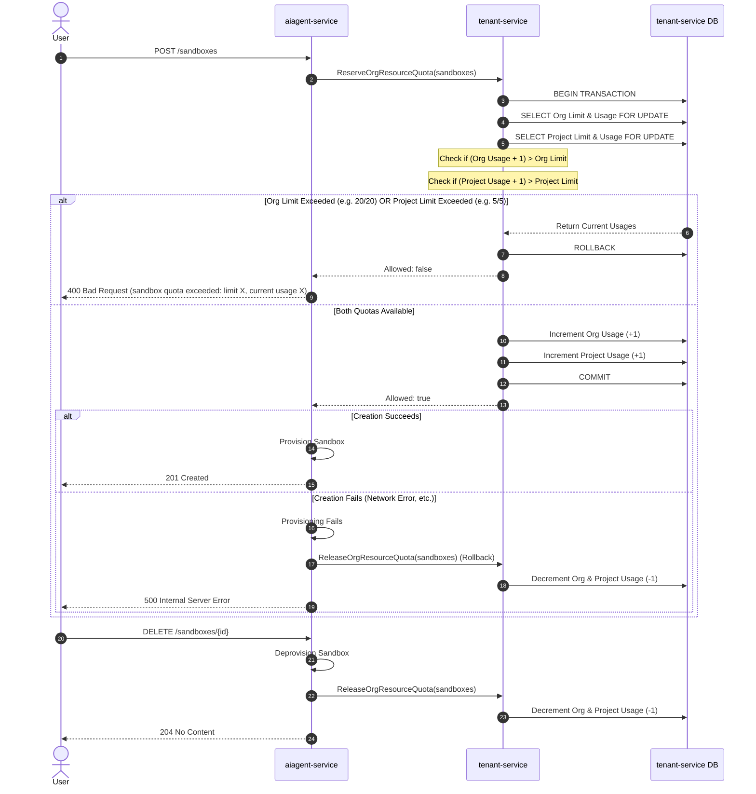

# RFC: Sandbox Quotas — Per-Org / Per-Project Ceilings

> **Status:** Implemented (v1)

## Authors

- Agents Team

## Problem Statement

v1 of the sandbox offering has no platform-side ceilings on
per-project resource use. A single project can create unbounded
concurrent sandboxes, run for unbounded CPU-hours, and exhaust
cluster capacity that other projects need. The parent RFC
([`rfc_sandboxes.md`](rfc_sandboxes.md)) names this as honour-
system today; the honour-system does not survive the first real
multi-tenant customer.

This RFC defines the quota surface needed to ship safely:

- **What's metered.** Concurrent active sandbox count per
  project, CPU-hours per billing period, egress bytes per
  billing period (when Phase 3's gateway lands), and storage
  bytes for persistent volumes. Each dimension needs a
  per-project ceiling and a per-org aggregate.
- **Where it's enforced.** At the API layer (reject
  `POST /sandboxes` over the concurrent cap with a clear
  error), at the runtime layer (terminate / pause sandboxes
  that overrun their CPU-hours budget), and at the egress layer
  (rate-limit or block over the egress-bytes cap).
- **How it's surfaced to customers.** Current usage vs. cap on
  the console dashboard, machine-readable headers on API
  responses (`X-Quota-Remaining`, `X-Quota-Reset`), and a clear
  error code (`quota_exceeded`) that customer agent code can
  catch and back off against.
- **How it's set.** Plan-tier defaults (free / starter /
  enterprise), per-tenant overrides for negotiated contracts,
  and a self-service "raise my limit" flow that doesn't require
  a support ticket for small bumps.

Required for v1 alongside isolation, observability, and
auditability — without quotas, the platform's multi-tenant
safety story has a hole that's catastrophic on the first
runaway agent.

## Architecture & Request Flow

This diagram illustrates the exact sequence of events when a user creates or deletes a sandbox, demonstrating how `aiagent-service` interacts with `tenant-service` to enforce limits safely.

## Detailed Implementation (Phase 1)

### 1. Database Quota Seeding
We store the default limits in the `tenant-service` database using the resource name `sandboxes`:
- **Organization Limit:** 20 sandboxes.
- **Project Limit:** 5 sandboxes.

### 2. Centralized Quota Engine
We use the centralized quota system in `tenant-service` to enforce sandbox limits.
- **Atomic Operations:** The system sequentially evaluates concurrent requests, guaranteeing that quotas are never over-allocated under heavy load.
- **Hierarchical Scope:** The system evaluates both the Project-level and Organization-level limits in a single transaction.

### 3. The "Create Sandbox" Flow
1. **Reserve:** Ask `tenant-service` to reserve 1 sandbox slot.
2. **Reject:** If the limit is reached, immediately return a standard `400 Bad Request` error.
3. **Rollback:** If the slot is reserved but the sandbox fails to create, safely return the slot so it is not permanently lost.

### 4. The "Delete Sandbox" Flow
1. **Release:** After deleting a sandbox, notify `tenant-service` to free up the slot for future use.

## Future Work

- **CPU-hours.** This prevents users from leaving sandboxes running forever. It will be built in the future by updating the sandbox reconciler to track and store exactly how long each sandbox has been running.
- **Egress bytes.** This will prevent a single sandbox from downloading terabytes of data and crashing the network. It will be built after the dedicated Sandbox Egress Gateway is launched to monitor network traffic.
