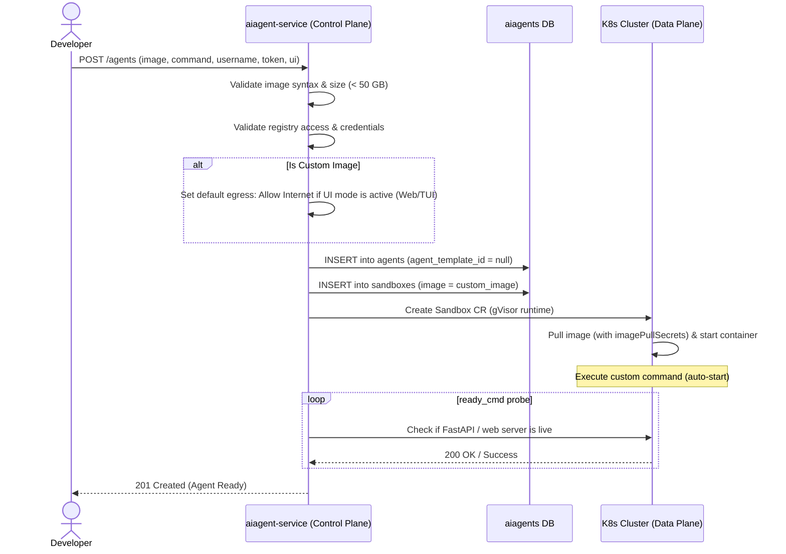

# Research: Bring-Your-Own-Image (BYOI) for Agent Templates

This document details the research, competitive analysis, and proposed architecture for extending the NeevAI Platform to support **Bring-Your-Own-Image (BYOI)** for custom Agent Templates.

## Problem Statement

Currently, the platform only allows users to launch agents using a fixed list of platform-provided templates. If a user wants to run their own custom container image for their agent, the platform restricts them from doing so. This document establishes the architecture and standard procedures required to securely register, validate, and execute these custom images within the platform.

## Goals

* **Run Custom Docker Images**: Allow users to run their own custom agent images directly by providing a registry path (e.g. `docker.io/myorg/myimage:v1`) when creating an agent.
* **Support Private Registries**: Allow users to pull images from locked/private container registries by providing their registry username and access token.
* **Select How the Agent Interface Works**: Allow users to specify how they want to talk to the agent (using a web UI, a terminal/command line, or running background API requests).
* **Choose Custom CPU, RAM, and Disk Sizing**: Assign standard system limits for container CPU, RAM, and Disk by default, but allow users to request custom sizes during creation.
* **Configure Allowed Websites (Network Egress)**: Users must explicitly list which external websites or networks their agent needs to access. If the user does not specify anything, all network access is blocked by default.
* **Preserve Platform Template Integrity**: Ensure existing platform-curated templates (e.g. Claude Code) continue to work seamlessly without modifications.

### Validation & Policy Goals
* **OCI Path Syntax Check**: Enforce strict syntax validation for custom OCI image references (requiring explicit domain/path and version tags, while rejecting the `:latest` tag).
* **Image Existence & Pull Validation**: Verify that the custom image exists and can be successfully pulled (with credentials if private) before declaring the container status as ready.
* **Rate Limits & Abuse Mitigation**: Enforce runtime limits (e.g. max image size of 50 GB) to prevent resource exhaustion and system abuse.

## Future Goals

* **Custom Template Registry**: Allow users to save their custom OCI image paths and private registry pull credentials as reusable, organization-scoped templates in the database, so they do not have to re-enter their registry token and image details on every launch request.
* **Secrets Manager**: Introduce a dedicated credential store allowing users to save registry credentials once and reference them across multiple custom agent launches, rather than providing the registry token every time.
* **Template Curation & Marketplace**: Provide a community sharing portal or public template marketplace for users to publish and share templates publicly.
* **Automated gVisor Syscall Probing**: Run automatic compatibility scans using dry-run sandboxes to verify custom images do not run blocked syscalls.
* **Supply Chain Security & Vulnerability Scanning**: Automate vulnerability scanning (SBOM/signing check) on custom images.

---

## Evaluate BYOI implementations and workflows across other agent/sandbox providers

To design a robust BYOI architecture, we analyzed three leading custom-sandbox/agent execution runtimes: **E2B**, **Daytona**, and **Modal**.

### E2B (Firecracker-based Sandboxes)
* **Security Architecture**: E2B uses Firecracker MicroVMs for hardware-level isolation. Each sandbox runs on a dedicated guest kernel, ensuring complete separation from the host system. The user's image is converted into an ext4 virtual disk and mounted as Read-Only, with a temporary Copy-On-Write (COW) layer to capture runtime changes.
* **Network Isolation & Egress Controls**: Sandboxes are completely isolated from one another on the network level. While outbound internet access is enabled by default, it can be strictly restricted. Developers can pass allow_internet_access=False when creating the sandbox to block all traffic, or configure fine-grained Allow/Deny lists to restrict the agent to specific IP ranges, CIDR blocks, or domains.
* **Base Image Constraints**: When users provide custom Docker images, the image must contain an /etc/os-release file (supported distros include Ubuntu, Debian, Alpine, Fedora, Arch). Extremely minimal images like scratch or distroless will fail to build, because E2B's internal networking daemon requires standard Linux OS files to bridge the network.
* **How the Custom Image is Handled**: When a user provides a custom Docker image, E2B doesn't just run it like a normal container. Instead, it goes through a specific Snapshotting Lifecycle:
  - **Initial Boot & Execution**: E2B converts the Docker image into a MicroVM and boots it up. Generally, E2B will attempt to execute the Dockerfile's default CMD instruction in the background to start the user's agent.
  - **The Port Binding Problem**: If the user's custom agent is a web server (like FastAPI), it takes a few moments for the server to start up and expose its network port. However, E2B takes a snapshot of the virtual machine almost instantly. This means the VM is often frozen into a snapshot before the network port has finished opening, resulting in a broken, unreachable server.
  - **The Snapshot Fix (ready_cmd)**: To solve this, the user must explicitly configure a start_cmd and a ready_cmd (e.g., curl -s -f http://localhost:8000) when building the template. This forces E2B to wait. E2B will only freeze the VM's memory and take the snapshot after the complete server has successfully run and the port is fully open.
  - **Sandbox Wake-up (Instant Resume)**: When the user later creates a sandbox (e.g., Sandbox.create()), E2B does not waste time booting an OS or running the startup script again. It simply loads the frozen snapshot into memory in milliseconds. Since the snapshot captured the server already running, the sandbox wakes up with the agent fully active, the port already open, and a public URL instantly ready for traffic.
* **Public URL Structure**: E2B natively exposes the port by prepending the port number to the Sandbox ID.
  - **Format**: `https://<port>-<sandbox_id>.e2b.dev`
  - **Example**: `https://8000-su92nc82hx.e2b.dev`

### Daytona (Cloud Development Environments)
* **Security Architecture & Isolation**: Daytona runs each sandbox in an isolated environment using Linux namespaces and, where configured, VM-based isolation. Each sandbox has its own filesystem, network stack, and allocated CPU/RAM, preventing untrusted code from directly accessing the host or other sandboxes.
* **Network Isolation & Egress Controls**: Daytona provides per-sandbox network isolation with firewall-based egress controls. Outbound traffic can be restricted using a networkAllowList for specific IP/CIDR ranges, a domainAllowList for approved domains, or networkBlockAll to block all outbound traffic. This helps prevent untrusted code from accessing unauthorized external services or exfiltrating data.
* **How the Custom Image is Handled**: Users have two primary ways to provision a custom image:
  - **Directly via UI/API**: Users can select "Image" as the source in the "Create Sandbox" interface and directly provide the OCI image tag.
  - **Via Repository**: Users can provide a GitHub repository containing a .devcontainer/devcontainer.json file, which Daytona reads to pull the specified image.
* **Does it start the agent automatically?**: NO (by default). Daytona is designed as an interactive Cloud Development Environment. It ignores standard Docker CMDs because it needs to start its own SSH daemon first.
* **Interface & Execution Flow**:
  - The primary interface is the Terminal (CLI) or IDE (VS Code).
  - The user provisions the workspace, SSHs into the machine, and manually runs the Python command in the terminal.
  - To achieve automatic startup, the user must explicitly define lifecycle scripts (like postStartCommand) inside their devcontainer.json.
  - Daytona natively exposes ports via secure web proxy URLs, but only after the server is actively listening.
* **Public URL Structure**: Daytona exposes ports via a predictable proxy domain routing.
  - **Format**: `https://<port>-<sandbox_id>.<daytona_proxy_domain>`
  - **Example**: `https://8000-5d96d764.daytonaproxy01.net`

### Modal (Serverless AI Runtimes)
* **Security Architecture**: Modal uses gVisor as its container runtime. gVisor acts as a userspace guest kernel that intercepts all system calls between the untrusted code and the host OS. This prevents malicious agents from accessing the host kernel while maintaining standard container execution speeds.
* **How the Custom Image is Handled**: Users define their images entirely programmatically in Python (e.g., modal.Image.from_registry("ubuntu:22.04")), or they import an OCI image directly.
* **Does it start the agent automatically?**: YES. Modal is entirely serverless and event-driven.
* **Interface & Execution Flow**:
  - The primary interface is the Web (HTTP Endpoint) or Modal SDK. There is no interactive terminal.
  - The developer annotates their Python function with decorators like @modal.web_endpoint().
  - When a user hits the auto-generated HTTPS URL, Modal instantly boots the custom image from a memory snapshot, executes the function, and returns the web response.
* **Public URL Structure**: Modal generates deterministic URLs based on the user's workspace and function name.
  - **Format**: `https://<workspace_name>--<app_name>-<function_name>.modal.run`
  - **Example**: `https://chandini--my-agent-web.modal.run`

---

## Image registration and management flow



### 1. Request Structure (`POST /agents`)

When launching a custom agent, the request body accepts the following inline image parameters:

```json
{
  "name": "custom-chat-agent",
  "image": "docker.io/myorg/custom-agent:v1.2",
  "registry_username": "my_docker_user",
  "access_token": "dckr_pat_...",
  "command": ["python", "app.py"],
  "ui": {
    "mode": "web",
    "port": 8080
  },
  "resources": {
    "cpu": 2,
    "memory_gb": 4,
    "disk_gb": 20
  }
}
```

* **`image` (string)**: The OCI image reference path.
* **`registry_username` / `access_token` (strings)**: Optional credentials to authenticate pulls if the image is hosted in a private registry.
* **`command` (array of strings)**: Custom entrypoint command to auto-start the agent.
* **`ui` (object)**: Configures the interface mode (`web`, `tui`, or `headless`) and port.

---

### 2. Detailed Execution Steps

#### Step 1: Pre-Launch Validation Checks
Before provisioning any resources, the platform runs the following checks on the custom OCI image:
* **Image Tag check**: Verifies the image path has a valid version tag/digest and is not using `:latest`.
* **Access & Credentials check**: Probes the OCI registry (using username and token if the registry is private) to ensure the image is accessible.
* **Image Size check**: Queries registry metadata to verify the image does not exceed the **50 GB** size limit.

#### Step 2: Database Setup
The agent is saved in the database with `agent_template_id` set to `NULL`. The custom OCI image path and startup command are stored in the backing `sandboxes` table.

#### Step 3: Container Boot & Auto-Start
The platform launches a container running the custom image under a secure gVisor sandbox. If private registry credentials were provided, they are injected as Kubernetes image pull secrets. Once the container is running, the platform automatically executes the custom startup `command` in the background.

#### Step 4: Interface Readiness Checks
The platform verifies the agent is fully loaded depending on the `ui.mode`:
* **`web`**: Periodically runs the `ready_cmd` test probe (e.g. checking the FastAPI health route) and delays marking the agent as ready until the server starts responding.
* **`tui`**: Waits for the helper agent (`sandboxd`) inside the container to start its terminal control socket before letting the user connect.
* **`headless`**: Marks the agent as ready immediately once the container has started running the custom command.

#### Step 5: Network Access Control (Egress)
* **Custom Rules**: If the user provides a list of allowed websites, the platform allows connections only to those addresses.
* **Default Rules**: If the user leaves the list empty, all outbound internet access is blocked by default. However, for interactive agents (`web` or `tui` UI modes), the platform automatically configures the network to allow internet access by default so the agent can connect to external model APIs (OpenAI/Anthropic).

---

### 3. Supported Image Formats & Requirements
* **Container Formats**: Supports Open Container Initiative (OCI) images and Docker Image Specification V2 Schema 2. 
* **Compression**: Standard gzip, zstd, and tarball layer compression types are fully supported.
* **Registry Protocols**: Supports OCI Distribution Spec v1 compliant registries (such as Docker Hub, GitHub Container Registry (GHCR), AWS ECR, and Google Artifact Registry).

### 4. Configuration & Environment-Variable Handling
* **Custom Environment Variables**: Any environment variables specified in the `POST /agents` request payload are securely injected into the pod definition at startup.
* **Platform Injections**: The platform automatically injects system environment variables (e.g. `SANDBOX_ID`, `ORG_ID`, `PROJECT_ID`) so the agent sidecar can authenticate and sync.
* **Sensitive Credentials**: If the user provides private registry access tokens, the platform encrypts the credentials at rest using a secure envelope encryption key. They are never exposed in system logs or environment variables.

### 5. Networking & Storage Expectations
* **Network Isolation**: The agent's pod network interface is managed by Cilium. Egress policies are applied dynamically to enforce network restrictions.
* **Storage Mounts**: The container's root filesystem is mounted as a copy-on-write (COW) layer. Any changes made by the agent during execution are temporary and will be discarded when the sandbox container is paused or recreated. 
* **Temp Storage**: A writable, high-performance `/tmp` directory is mounted using ephemeral local pod storage, allowing the agent to write scratch files and socket connections.

### 6. Versioning & Image Lifecycle Management
* **Version Pins**: Custom images must use an explicit tag or sha256 digest pin. The `:latest` tag is rejected to guarantee predictability.
* **Agent Lifecycle**: 
  - **Create**: Pulls the specific OCI image tag, registers the database state, and boots the container.
  - **Pause/Resume**: Freezes container execution (using gVisor memory state snapshotting) to save CPU/memory resources when the agent is idle, and resumes instantly.
  - **Delete**: Cleans up the backing pod in Kubernetes, removes the database rows, and deletes the temporary registry pull secrets.
