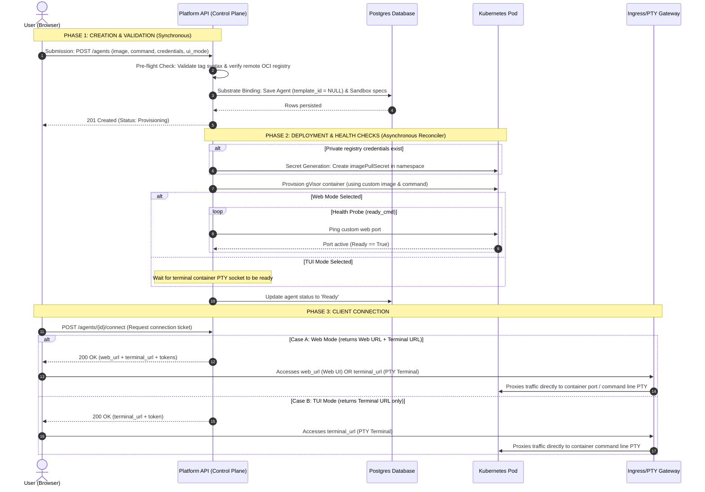

# Bring-Your-Own-Image (BYOI) for Agent Templates

## Problem Statement

Currently, the platform only allows users to launch agents using a fixed list of platform-provided templates. If a user wants to run their own custom container image for their agent, the platform restricts them from doing so. This document establishes the architecture and standard procedures required to securely register, validate, and execute these custom images within the platform.

## Goals

* Allow users to run their own custom agent images directly by providing a registry path (e.g. `docker.io/myorg/myimage:v1`) when creating an agent.
* Allow users to pull images from private container registries by providing their registry username and access token.
* Allow users to specify how they want to talk to the agent (using a web UI, a terminal/command line, or running background API requests).
* Assign standard system limits for container CPU, RAM, and Disk by default, but allow users to request custom sizes during creation.
* Users must explicitly list which external websites or networks their agent needs to access. If the user does not specify anything, all network access is blocked by default.
* Ensure existing platform-curated templates continue to work seamlessly without modifications.


## Future Goals

* **Custom Template Registry**: Allow users to save their custom OCI image paths and private registry pull credentials as reusable, organization-scoped templates in the database, so they do not have to re-enter their registry token and image details on every launch request.
* **Centralized Registry Credentials Storage (Secrets Manager)**: Introduce a dedicated, centralized credential store (similar to the `airuntime_template_registry_creds` schema used in `airuntime-service`). Users register their private registry credentials once. During agent creation, they pass a `credential_id` reference instead of raw tokens. The control plane fetches the encrypted credential, decrypts it, and automatically creates the required Kubernetes `imagePullSecrets` inside the agent's project namespace at run time.

---

## Evaluate BYOI implementations and workflows across other agent/sandbox providers

To design a robust BYOI architecture, we analyzed three leading custom-sandbox/agent execution runtimes: **E2B**, **Daytona**, and **Modal**.

### E2B (Firecracker-based Sandboxes)
* **Security Architecture**: E2B uses Firecracker MicroVMs for hardware-level isolation. Each sandbox runs on a dedicated guest kernel, ensuring complete separation from the host system. The user's image is converted into an ext4 virtual disk and mounted as Read-Only, with a temporary Copy-On-Write (COW) layer to capture runtime changes.
* **Network Isolation & Egress Controls**: Sandboxes are completely isolated from one another on the network level. While outbound internet access is enabled by default, it can be strictly restricted. Developers can pass allow_internet_access=False when creating the sandbox to block all traffic, or configure fine-grained Allow/Deny lists to restrict the agent to specific IP ranges, CIDR blocks, or domains.
* **Base Image Constraints**: When users provide custom Docker images, the image must contain an /etc/os-release file (supported distros include Ubuntu, Debian, Alpine, Fedora, Arch). Extremely minimal images like scratch or distroless will fail to build, because E2B's internal networking daemon requires standard Linux OS files to bridge the network.
* **How the Custom Image is Handled**: When a user provides a custom Docker image, E2B doesn't just run it like a normal container. Instead, it goes through a specific Snapshotting Lifecycle:
  - **Initial Boot & Execution**: E2B converts the Docker image into a MicroVM and boots it up. Generally, E2B will attempt to execute the Dockerfile's default CMD instruction in the background to start the user's agent.
  - **The Port Binding Problem**: If the user's custom agent is a web server (like FastAPI), it takes a few moments for the server to start up and expose its network port. However, E2B takes a snapshot of the virtual machine almost instantly. This means the VM is often frozen into a snapshot before the network port has finished opening, resulting in a broken, unreachable server.
  - **The Snapshot Fix (ready_cmd)**: To solve this, the user must explicitly configure a start_cmd and a ready_cmd (e.g., curl -s -f http://localhost:8000) when building the template. This forces E2B to wait. E2B will only freeze the VM's memory and take the snapshot after the complete server has successfully run and the port is fully open.
  - **Sandbox Wake-up (Instant Resume)**: When the user later creates a sandbox (e.g., Sandbox.create()), E2B does not waste time booting an OS or running the startup script again. It simply loads the frozen snapshot into memory in milliseconds. Since the snapshot captured the server already running, the sandbox wakes up with the agent fully active, the port already open, and a public URL instantly ready for traffic.
* **Public URL Structure**: E2B natively exposes the port by prepending the port number to the Sandbox ID.
  - **Format**: `https://<port>-<sandbox_id>.e2b.dev`
  - **Example**: `https://8000-su92nc82hx.e2b.dev`

### Daytona (Cloud Development Environments)
* **Security Architecture & Isolation**: Daytona runs each sandbox in an isolated environment using Linux namespaces and, where configured, VM-based isolation. Each sandbox has its own filesystem, network stack, and allocated CPU/RAM, preventing untrusted code from directly accessing the host or other sandboxes.
* **Network Isolation & Egress Controls**: Daytona provides per-sandbox network isolation with firewall-based egress controls. Outbound traffic can be restricted using a networkAllowList for specific IP/CIDR ranges, a domainAllowList for approved domains, or networkBlockAll to block all outbound traffic. This helps prevent untrusted code from accessing unauthorized external services or exfiltrating data.
* **How the Custom Image is Handled**: Users have two primary ways to provision a custom image:
  - **Directly via UI/API**: Users can select "Image" as the source in the "Create Sandbox" interface and directly provide the OCI image tag.
  - **Via Repository**: Users can provide a GitHub repository containing a .devcontainer/devcontainer.json file, which Daytona reads to pull the specified image.
* **Does it start the agent automatically?**: NO (by default). Daytona is designed as an interactive Cloud Development Environment. It ignores standard Docker CMDs because it needs to start its own SSH daemon first.
* **Interface & Execution Flow**:
  - The primary interface is the Terminal (CLI) or IDE (VS Code).
  - The user provisions the workspace, SSHs into the machine, and manually runs the Python command in the terminal.
  - To achieve automatic startup, the user must explicitly define lifecycle scripts (like postStartCommand) inside their devcontainer.json.
  - Daytona natively exposes ports via secure web proxy URLs, but only after the server is actively listening.
* **Public URL Structure**: Daytona exposes ports via a predictable proxy domain routing.
  - **Format**: `https://<port>-<sandbox_id>.<daytona_proxy_domain>`
  - **Example**: `https://8000-5d96d764.daytonaproxy01.net`

### Modal (Serverless AI Runtimes)
* **Security Architecture**: Modal uses gVisor as its container runtime. gVisor acts as a userspace guest kernel that intercepts all system calls between the untrusted code and the host OS. This prevents malicious agents from accessing the host kernel while maintaining standard container execution speeds.
* **How the Custom Image is Handled**: Users define their images entirely programmatically in Python (e.g., modal.Image.from_registry("ubuntu:22.04")), or they import an OCI image directly.
* **Does it start the agent automatically?**: YES. Modal is entirely serverless and event-driven.
* **Interface & Execution Flow**:
  - The primary interface is the Web (HTTP Endpoint) or Modal SDK. There is no interactive terminal.
  - The developer annotates their Python function with decorators like @modal.web_endpoint().
  - When a user hits the auto-generated HTTPS URL, Modal instantly boots the custom image from a memory snapshot, executes the function, and returns the web response.
* **Public URL Structure**: Modal generates deterministic URLs based on the user's workspace and function name.
  - **Format**: `https://<workspace_name>--<app_name>-<function_name>.modal.run`
  - **Example**: `https://chandini--my-agent-web.modal.run`

---

## Implementation Plan

1. **User Request**: User requests agent creation by giving their custom OCI image path and selecting the UI Mode: `tui` (terminal) or `web` (web dashboard).
2. **Registry Verification**: The system checks if the image exists in the registry, reads its size (must be under 50 GB), and validates the tag (rejects `:latest`).
3. **Secret Setup**: If the registry is private, the system creates a secure Kubernetes image pull secret in the namespace.
4. **Database Registration**: The system saves the agent template as `NULL` in the `agents` table, and stores the image path and command inside the `sandboxes` table.
5. **Container Booting**: A container pod spins up using the user-provided custom image.
6. **Egress Firewall Rules**:
   - **TUI Mode**: Outbound internet is blocked by default. The user can configure their own custom egress/firewall rules.
   - **Web Mode**: Outbound HTTP/HTTPS network access is enabled by default. This ensures the external ingress gateway can securely map and route incoming preview URL traffic to the running container port, and allows the web agent to communicate with necessary external APIs.
7. **Health Probing (Startup Delay Guard)**:
   - For web-based agents, the system runs a `ready_cmd` check (like `curl -s -f http://localhost:8080`) to check if the port is open.
   - The agent is marked as `Ready` only after the `ready_cmd` probe succeeds, preventing any "404 Not Found" errors.
8. **User Connection**:
   - **TUI Agent**: The frontend opens an interactive terminal (PTY over WebSocket) as the main interface.
   - **Web Agent**: The frontend loads the web URL as the primary interface, but **also** provides an optional terminal (PTY) connection so the user can interact via command line directly.
   - **How the Web Preview URL is Generated**:
     - The Control Plane (`aiagent-service`) generates the public preview URL dynamically by combining the sandbox ID and region with the platform's ingress gateway domain pattern (e.g., `https://<sandbox_id>-ui.sandboxes.<region>.neevcloud.com`).
     - When the user opens this URL, the `sandbox-ingress-gateway` validates the access token and proxies HTTP/WebSocket traffic directly to the agent container's designated UI port.


## Database Migration Schema

The database requires modifications to allow `agent_template_id` to be nullable in the `agents` table and a new table to store encrypted private registry credentials, mirroring the `airuntime` structure.

```sql
-- Migration: v0.8.1_allow_byoi_agents.up.sql

-- 1. Make agent_template_id optional for custom BYOI agents
ALTER TABLE agents ALTER COLUMN agent_template_id DROP NOT NULL;

-- 2. Add index to query BYOI agents efficiently
CREATE INDEX IF NOT EXISTS idx_agents_byoi ON agents(project_id) WHERE agent_template_id IS NULL;

-- 3. Create table to store private registry credentials (encrypted)
CREATE TABLE IF NOT EXISTS agent_registry_creds (
    id          UUID         PRIMARY KEY DEFAULT gen_random_uuid(),
    agent_id    UUID         NOT NULL REFERENCES agents(id) ON DELETE CASCADE,
    username    TEXT         NOT NULL,
    token       TEXT         NOT NULL, -- Encrypted access token
    created_at  TIMESTAMPTZ  NOT NULL DEFAULT NOW(),
    updated_at  TIMESTAMPTZ  NOT NULL DEFAULT NOW()
);

-- Index for querying credentials by agent
CREATE INDEX IF NOT EXISTS idx_agent_registry_creds_agent_id ON agent_registry_creds(agent_id);
```

---

## Sequence Diagram



---

## API Payload Changes (Extensions to Existing APIs)

### 1. Create Agent (Supporting both Catalogue & BYOI)
**Endpoint**: `POST /api/v1beta1/orgs/{org_id}/projects/{project_id}/agents`

**Request Body (BYOI Example)**:
```json
{
  "name": "my-custom-assistant",
  "image": "docker.io/myorg/custom-agent:v1.2.0",
  "command": ["python", "main.py", "--port", "8080"],
  "ui": {
    "mode": "web",
    "port": 8080
  },
  "resources": {
    "cpu_millicores": 2000,
    "memory_bytes": 4294967296,
    "disk_bytes": 21474836480
  },
  "egress": {
    "mode": "allow_list",
    "allow": [
      { "host": "api.openai.com" },
      { "host": "github.com" }
    ]
  },
  "env": {
    "AGENT_ROLE": "summarizer"
  },
  "registry_username": "my_docker_user",
  "access_token": "dckr_pat_..."
}
```

**Response (`201 Created`)**:
```json
{
  "id": "7b79a6d3-2fbf-4c74-8db5-1b5e7d58d928",
  "name": "my-custom-assistant",
  "sandbox_id": "ab79a6d3-2fbf-4c74-8db5-1b5e7d58d928",
  "status": "Provisioning",
  "created_at": "2026-08-24T15:45:00Z"
}
```

---

### 2. Connect to Agent UI (Terminal PTY or Preview URL)
**Endpoint**: `POST /api/v1beta1/orgs/{org_id}/projects/{project_id}/agents/{agent_id}/connect`

**Response (`200 OK`)**:
```json
{
  "drive_mode": "pty",
  "connect_url": "wss://term.us-west.neevcloud.com/a/ab79a6d3-2fbf-4c74-8db5-1b5e7d58d928",
  "token": "ey...",
  "expires_at": "2026-08-24T16:00:00Z"
}
```

---


## Supported image formats and requirements

* **Supported OS/Architecture**: Only Linux-based `amd64` architecture images are supported. Images built for other architectures (like `arm64`) are rejected.
* **Supported Registries**: Works with standard OCI container registries, including Docker Hub, GitHub Container Registry (GHCR), Red Hat Quay, AWS ECR, and Google Artifact Registry.
* **Base Image Shell Requirement**: The platform supports both standard base images (like `alpine`, `ubuntu`, `debian`) and minimal images (like `scratch` or `distroless`). However, minimal images lack shell binaries (like `/bin/sh` or `/bin/bash`), meaning interactive terminal (PTY) connections will fail. We highly recommend using base images that include a shell if you need command-line console access and debugging.

---

## Runtime & Security Constraints

* **gVisor Isolation**: All BYOI agents run under gVisor (with runsc). Untrusted system calls are intercepted by the Sentry guest kernel. Any custom image executing blocked syscalls (like raw hardware control or direct network interface manipulation) will be killed with `SIGSYS`.
* **Resource Limits**: Hard memory and CPU limits are applied. CPU is throttled via CFS shares. Out-of-memory (OOM) inside gVisor kills the container process without impacting the host node.
* **Egress Policy (Cilium)**: All egress traffic is filtered at the network layer. If no egress rules are specified, all traffic outside the local network is blocked. For interactive web/TUI agents, the platform allows outgoing ports `80` and `443` to common AI providers by default.
* **File System overlays**: The container rootfs is mounted as a copy-on-write overlay. All modifications to the rootfs are discarded on container reboot/recreation. Durable changes must be written to `/workspace` (persisted on PVC).

---

## Configuration and environment-variable handling

* **User Environment Variables**: User-defined environment variables are injected into the pod spec at creation.
* **Credential Protection**: Registry credentials (`access_token`) are encrypted at rest using AES-GCM symmetric encryption in the database (using the key managed by the Control Plane). When creating the temporary Kubernetes Secret of type `kubernetes.io/dockerconfigjson` in the namespace, the credentials are base64-encoded.

---

## Networking and storage expectations

* **Storage Mounts**:
  * `/workspace`: An empty persistent disk (PVC) mounted when the container starts for the first time. Any files generated or executed after the container starts must be saved in `/workspace` to persist across container restarts. This directory is shared with the sandbox manager sidecar daemon.
  * `/tmp`: Ephemeral local storage (`emptyDir`) for temporary cache files. Capped by disk quota and wiped on restarts.
* **Port Mapping**: A custom agent utilizing `web` UI mode must bind to the port specified in `ui.port` on all interfaces (`0.0.0.0`) so the system can forward traffic from the `sandbox-ingress-gateway` to this designated container port.

---

## Versioning and image lifecycle management

* **Explicit Tag Check**: All custom container images must specify a precise version tag (e.g. `:v1.2.0`) or digest; the mutable `:latest` tag is strictly blocked to prevent unpredictable image shifts during pause/resume cycles.
* **Image Caching & Pull Policy**: It uses the `IfNotPresent` pull policy to accelerate container boot and restore times by leveraging cached OCI layers.
* **Image Updates & Syncing**: If a user updates their image in their remote OCI registry under an existing tag, the platform will not automatically pull the new layers. To force-update the running agent, the user must update the template configuration with a new tag version or a unique SHA256 digest reference.
* **Node Garbage Collection**: When no active agent sandboxes are referencing a custom image, the cluster node's local container runtime garbage collector will eventually prune the cached layers to free up host disk space.

---

## Validation and compatibility checks

* **OCI Path Syntax Check**: Enforce strict syntax validation for custom OCI image references (requiring explicit domain/path and version tags, while rejecting the `:latest` tag).
* **Image Existence & Pull Validation**: Verify that the custom image exists and can be successfully pulled (with credentials if private) before declaring the container status as ready.
* **Rate Limits & Abuse Mitigation**: Enforce runtime limits (e.g. max image size of 50 GB) to prevent resource exhaustion and system abuse.

---

## Open Questions

* **NeevCloud Base Images**: Should the platform provide a standard base OCI image (e.g. `cr.neevcloud.com/ai/base-agent:v1`) containing pre-installed tools like `git`, `wget`, `curl`, `tar`, and `bash` to ensure user images are fully compatible with terminal PTY and snapshot flows?
